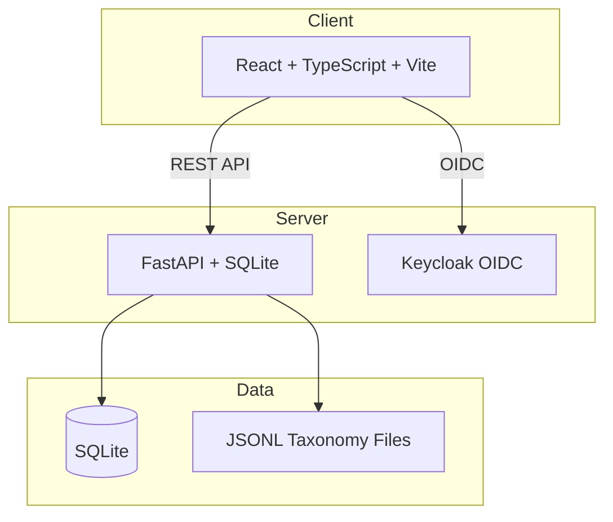

# tensor-pilot-ryan-vo — Ryan Vo

> Work in progress. This checkpoint may be incomplete or fail tests. See PLAN.md and STATUS.md before use.


AI/ML developer tool for explorable prerequisite taxonomies with custom domain support, learning progress tracking, and graph quality validation.

**Ryan Vo | AI & Machine Learning**

## Overview

tensor-pilot-ryan-vo is a full-stack application for exploring, validating, and tracking learning progress across prerequisite-based taxonomies. It addresses real needs from the Marble os-taxonomy community:

- **Custom Domain Support** (Issue #24): Load and visualize custom taxonomies beyond primary education
- **Learning Progress Tracker** (Issue #16): Per-child concept states with local persistence
- **Graph Linkage Validation** (Issue #18): Detect incoherent prerequisite relationships
- **Performance Optimization** (Issue #19): Smooth graph interaction at scale

## Architecture



## Quick Start

### Prerequisites
- Docker and Docker Compose
- Node 24+ (for local frontend development)
- Python 3.12+ (for local backend development)

### Using Docker Compose (Recommended)

```bash
# Copy environment template
cp .env.example .env

# Start all services
docker-compose up -d

# Access:
# Frontend: http://localhost:8080
# Backend API: http://localhost:8000/api/v1/health
# Keycloak Admin: http://localhost:8081 (admin/admin)
```

### Local Development

**Backend:**
```bash
cd backend
python3 -m venv .venv
source .venv/bin/activate
pip install -r requirements.txt
cp ../.env.example .env
uvicorn app.main:app --reload --host 127.0.0.1 --port 8000
```

**Frontend:**
```bash
cd frontend
npm install
npm run dev
```

## API Endpoints

| Method | Endpoint | Description |
|--------|----------|-------------|
| GET | `/api/v1/health` | Health check |
| GET | `/api/v1/concepts/` | List concepts (paginated) |
| GET | `/api/v1/concepts/{id}` | Get concept details |

## Testing

**Backend:**
```bash
PYTHONPATH=backend .venv/bin/python -m pytest backend/tests/ -v
```

**Frontend:**
```bash
cd frontend && npm test
```

**Full CI (Docker):**
```bash
docker-compose -f docker-compose.yml -f docker-compose.ci.yml up --build --abort-on-container-exit
```

## Configuration

| Variable | Description | Default |
|----------|-------------|---------|
| `DATABASE_URL` | SQLite database path | `sqlite+aiosqlite:///./data/tensor_pilot.db` |
| `CORS_ORIGINS` | Allowed CORS origins | `http://localhost:5173,http://127.0.0.1:5173` |
| `LLM_PROVIDER` | LLM provider type | `openai-compatible` |
| `LLM_MODEL` | Model name | - |
| `LLM_BASE_URL` | Custom API base URL | - |
| `LLM_API_KEY` | API key (server-side only) | - |
| `OIDC_ISSUER_URL` | Keycloak realm URL | - |
| `OIDC_CLIENT_ID` | OIDC client ID | - |
| `OIDC_CLIENT_SECRET` | OIDC client secret | - |
| `OIDC_REDIRECT_URI` | OAuth redirect URI | - |

## Security

- **Authentication**: OIDC authorization code flow with PKCE via Keycloak
- **Session Management**: HttpOnly SameSite cookies with CSRF protection
- **Roles**: `viewer` (read), `operator` (write), `admin` (manage)
- **LLM Keys**: Server-side only, never exposed to frontend
- **Production**: Demo mode explicitly disabled; TLS termination required at reverse proxy

## Deployment

### TLS Reverse Proxy (Required for Production)

```nginx
# Example nginx config
server {
    listen 443 ssl http2;
    server_name your-domain.com;
    
    ssl_certificate /path/to/cert.pem;
    ssl_certificate_key /path/to/key.pem;
    
    location / {
        proxy_pass http://127.0.0.1:8080;
        proxy_set_header Host $host;
        proxy_set_header X-Real-IP $remote_addr;
        proxy_set_header X-Forwarded-For $proxy_add_x_forwarded_for;
        proxy_set_header X-Forwarded-Proto $scheme;
    }
    
    location /api/ {
        proxy_pass http://127.0.0.1:8000;
        proxy_set_header Host $host;
        proxy_set_header X-Real-IP $remote_addr;
        proxy_set_header X-Forwarded-For $proxy_add_x_forwarded_for;
        proxy_set_header X-Forwarded-Proto $scheme;
    }
}
```

### Backup/Restore

```bash
# Backup
docker run --rm -v tensor-pilot-data:/data -v $(pwd):/backup alpine tar czf /backup/backup-$(date +%F).tar.gz -C /data .

# Restore
docker run --rm -v tensor-pilot-data:/data -v $(pwd):/backup alpine tar xzf /backup/backup-<date>.tar.gz -C /data
```

## AI/ML Evaluation

This tool supports AI/ML workflows through:
- **Prerequisite graph analysis** for curriculum design
- **Learning pathway optimization** using graph algorithms
- **Optional LLM explanations** (advisory-only, grounded in actual records)
- **Reproducible baselines** for taxonomy quality metrics

Run evaluation:
```bash
# Backend tests with domain logic
PYTHONPATH=backend .venv/bin/python -m pytest backend/tests/ -v -k "graph or taxonomy"
```

## License

MIT License

Copyright (c) 2026 Ryan Vo <ryandtvo@gmail.com>

## Author

**Ryan Vo**  
ryandtvo@gmail.com  
GitHub: [@A220man](https://github.com/A220man)